# Evidencias · Unidad III · Actividad 3

Capturas reales del dashboard y GraphiQL sobre una base de práctica aislada con **MySQL Community 8.4.7**, obtenidas el 23 de noviembre de 2026. Se usaron las cinco personas del laboratorio descrito en el README. Las imágenes y registros no incluyen contraseñas ni tokens. El preparador no modificó la base de actividades anteriores.

## Matriz inicial

Los cuatro roles y diez permisos coinciden con la sección 2.2; Administrador está deshabilitado y los nombres se leen del catálogo.

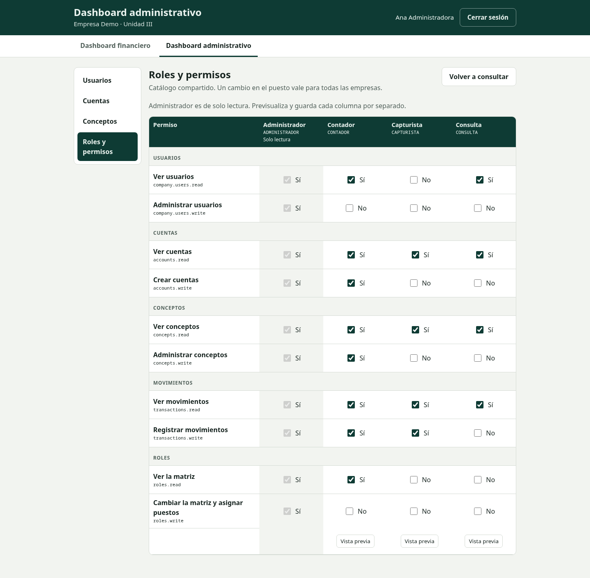

## Capturista en GraphiQL

`rolePermissions` devuelve las cuatro concesiones iniciales de Capturista: lectura de cuentas, conceptos y movimientos, más registro de movimientos.

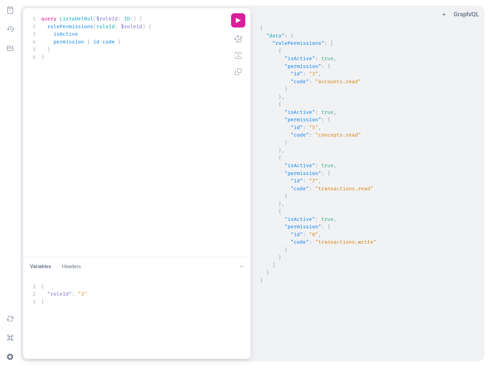

La respuesta también se conserva en [JSON](evidencias/rolePermissions-inicial.json), sin encabezados privados.

## Vista previa

Al marcar Crear cuentas, el API anuncia activar `accounts.write`, ninguna desactivación, cuatro sin cambio y total final cinco; todavía no se ha escrito la columna.

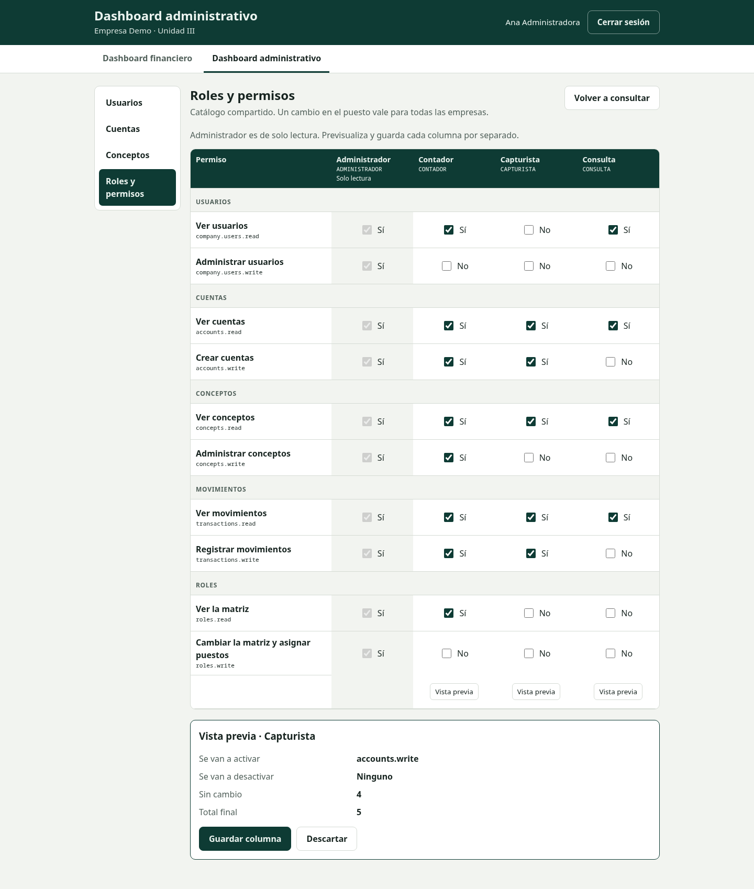

## Cuentas antes y después

María no tiene Nueva cuenta antes del guardado; después de guardar la columna y volver a consultar con su sesión existente, el botón aparece.

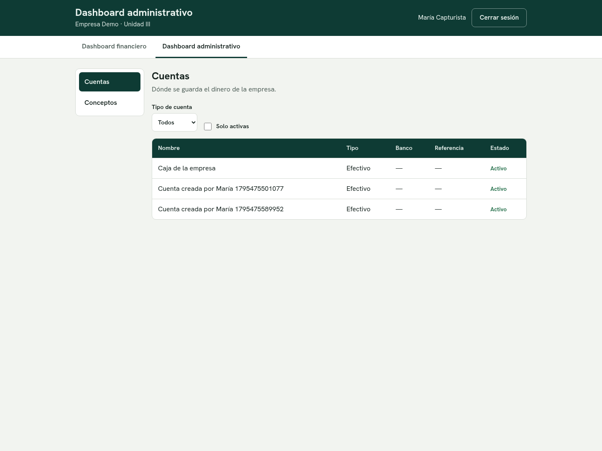

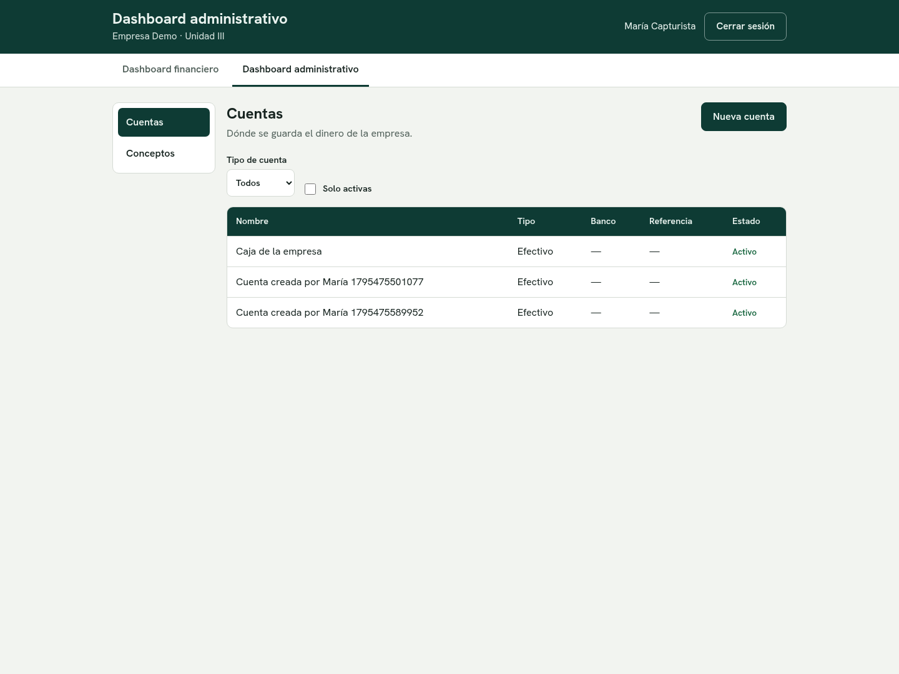

José también ve Nueva cuenta sin editar su membresía: ambos comparten la columna Capturista.

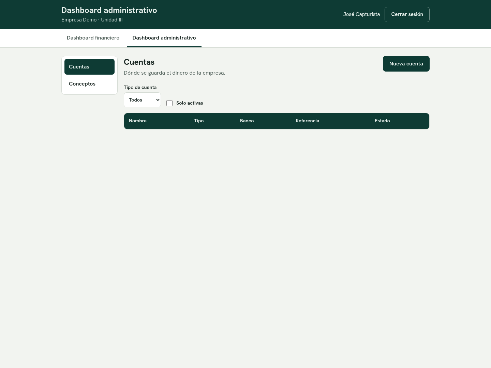

## Cambio de puesto en Usuarios

`assignRole` cambia a Pedro de Consulta a Capturista; la tabla muestra el resultado confirmado y Administrador permanece en No.

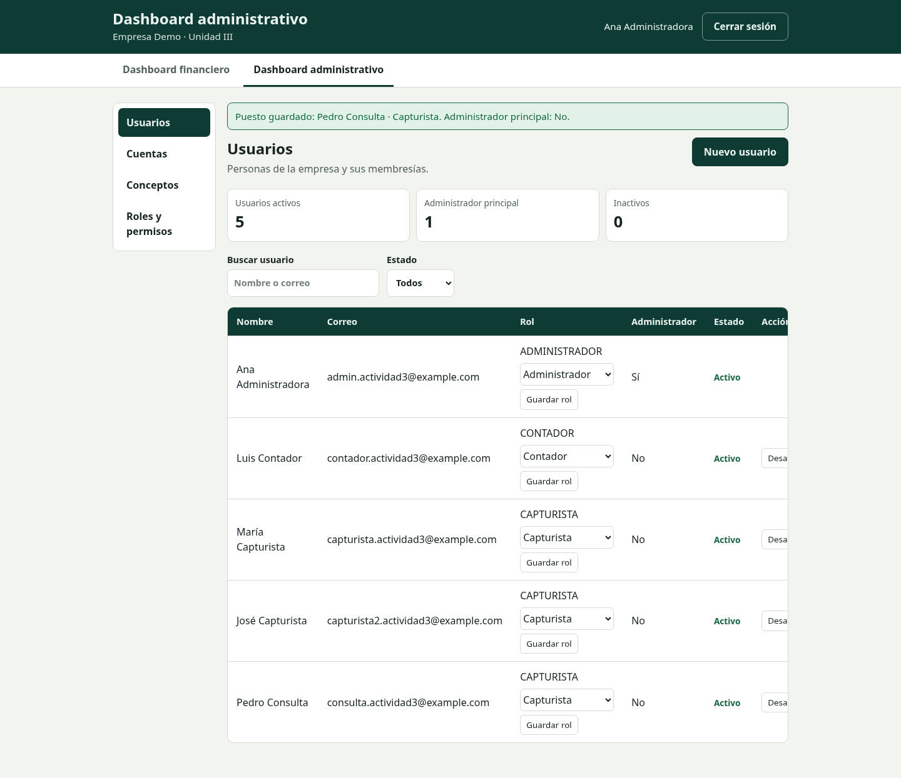

La columna Consulta conserva sus cuatro concesiones: cambiar una membresía no cambia la matriz.

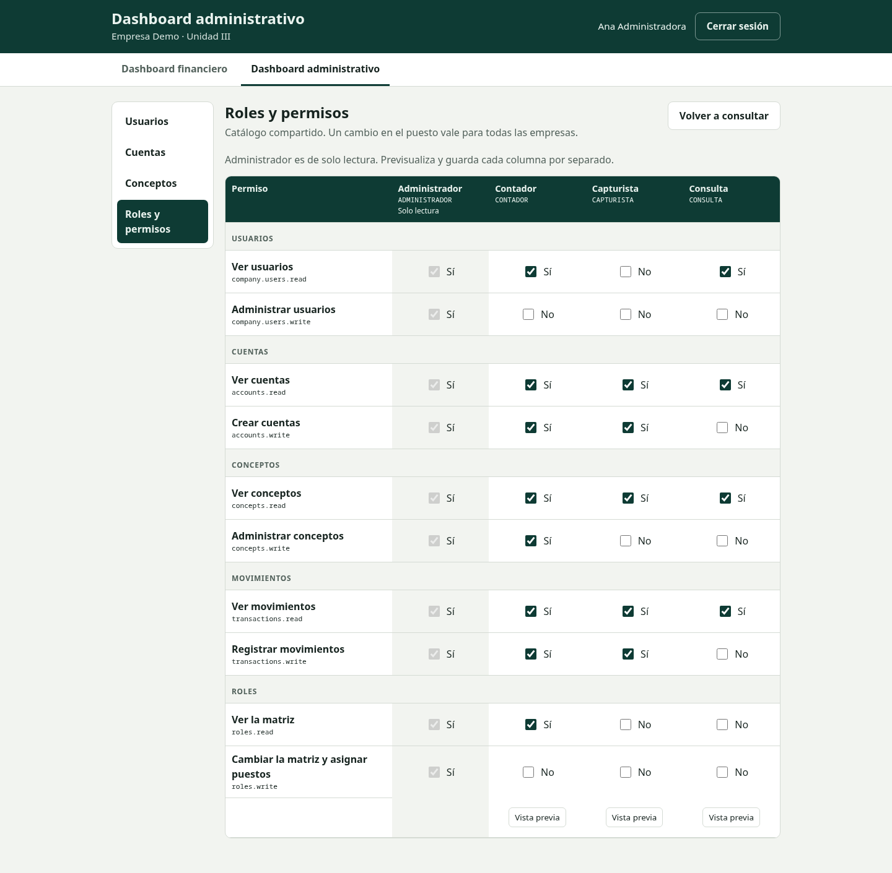

Pedro registra un movimiento desde el dashboard financiero con exactamente el JWT que tenía antes del cambio; el navegador compara ambos tokens en memoria y no los guarda en el registro público.

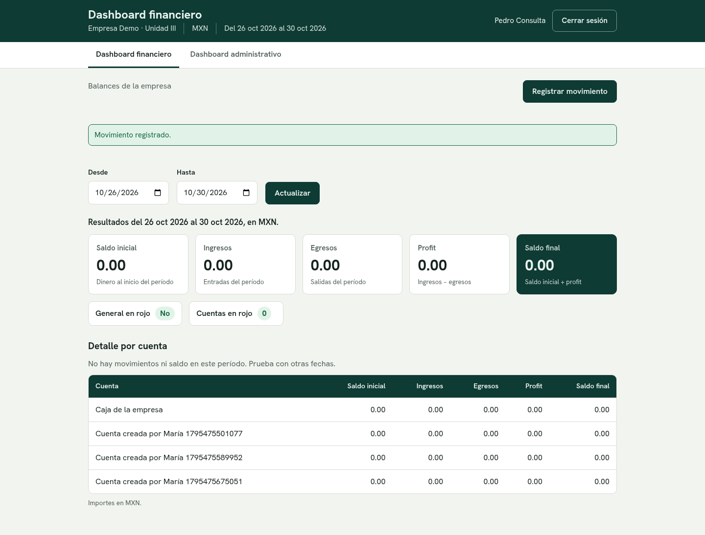

## Segundo guardado

Volver a previsualizar y guardar la misma columna devuelve `changed: false`, total final cinco y ninguna relación duplicada.

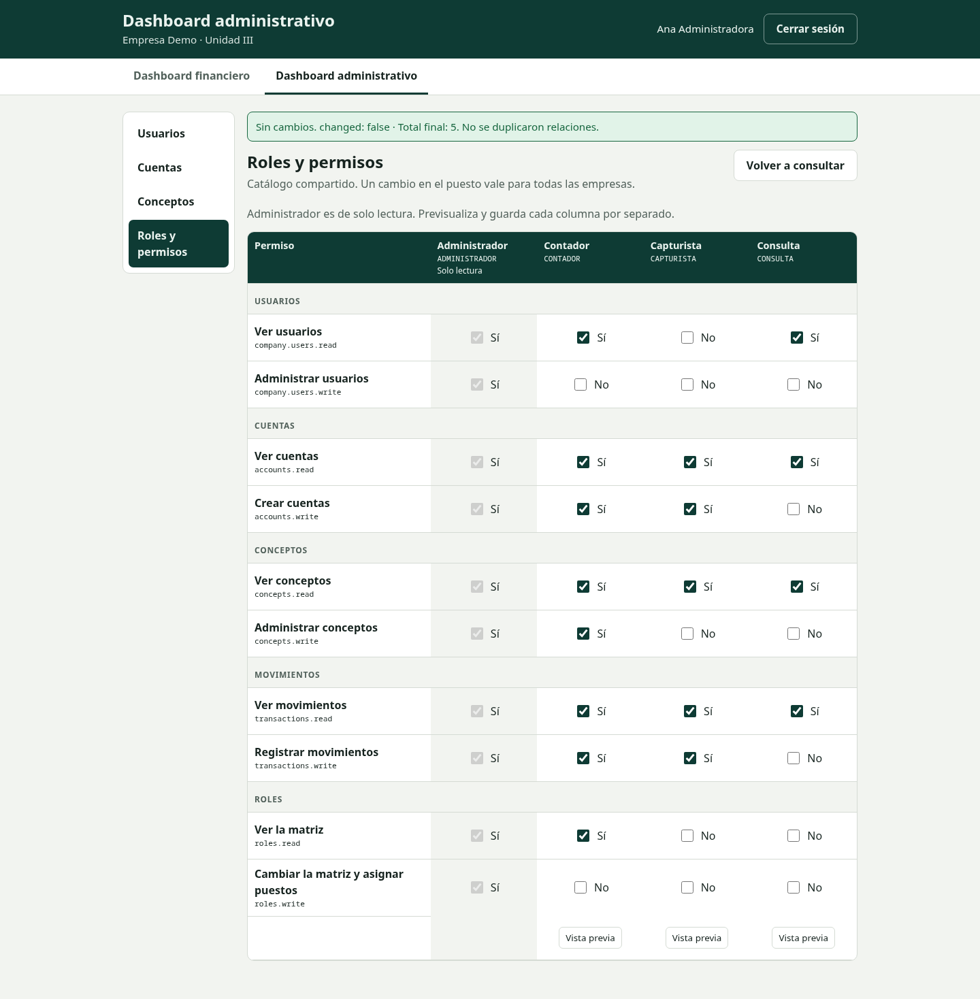

## Contador en solo lectura

Luis ve la matriz, pero las 40 casillas están deshabilitadas y no se muestran controles de vista previa o guardado.

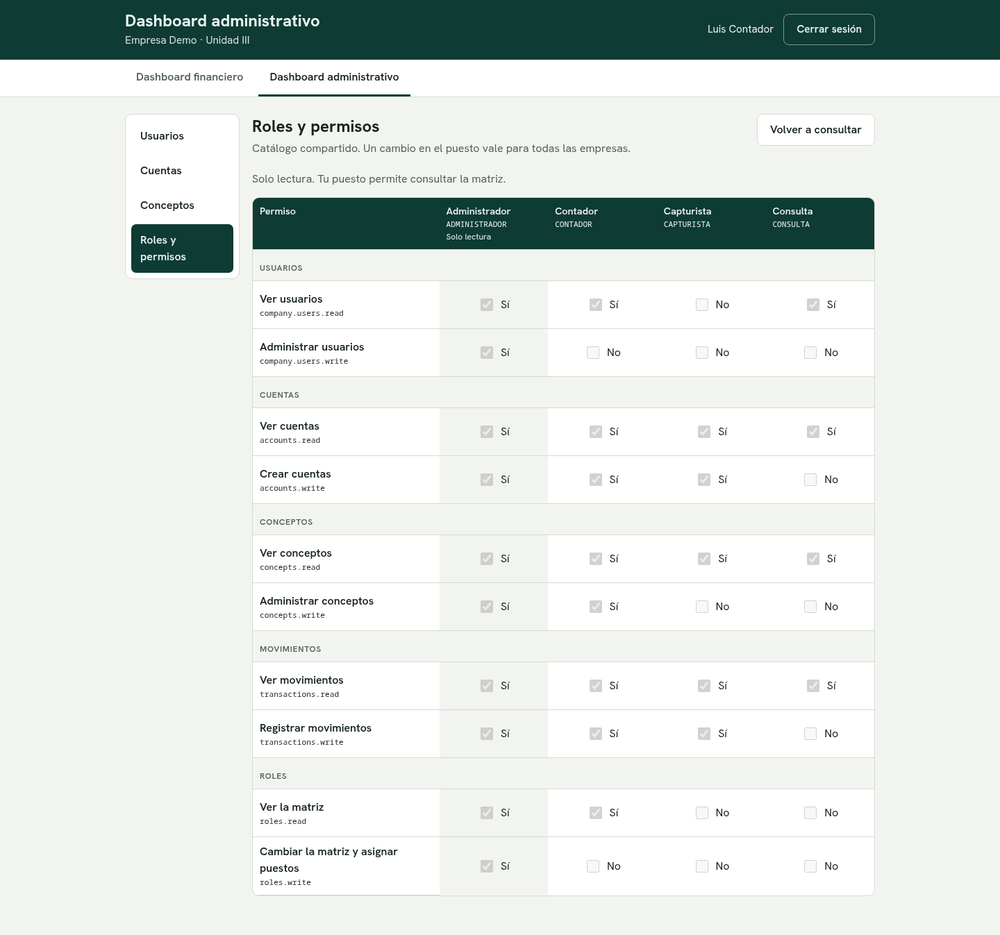

## Revocación y móvil

Al retirar `accounts.write`, Nueva cuenta desaparece para María y José; la cuenta creada se conserva y la relación pasa a inactiva.

En 390 píxeles de ancho, la cuadrícula se desplaza dentro de su contenedor y la página no se desborda.

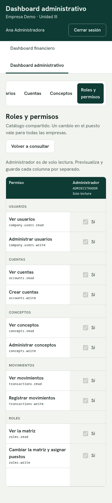

## Comprobaciones reproducibles

- [Suite completa en SQLite](evidencias/pytest-sqlite.txt) y [JUnit](evidencias/pytest-sqlite.xml).
- [Siete pruebas de integración en MySQL](evidencias/roles-mysql.txt) y [JUnit](evidencias/roles-mysql.xml): matriz inicial, efectos en dos sesiones, asignación sin alterar `isAdmin` ni matriz, vista previa/idempotencia/reactivación, persistencia de una columna vacía tras reinicio y nueve casos de autenticación con el mismo JWT.
- [Registro del navegador](evidencias/navegador.json): comprobaciones del cliente real, incluidos rechazo del API sin permiso y rechazo simulado de `assignRole` para verificar que el selector recupera el puesto confirmado. Esta simulación adicional no se usa como evidencia de persistencia.
- [Estado final consultado en MySQL](evidencias/estado-mysql.json): relaciones históricas conservadas y restauración de la matriz y el puesto de Pedro al terminar las capturas.

El script `scripts/activity3_evidence.cjs` comprueba cada resultado antes de capturarlo. Restaura la columna Capturista y el puesto Consulta de Pedro; conserva cuentas y movimientos de práctica. Los escenarios usan operaciones HTTP con Bearer y el cliente no envía `actorCompanyUserId`.
